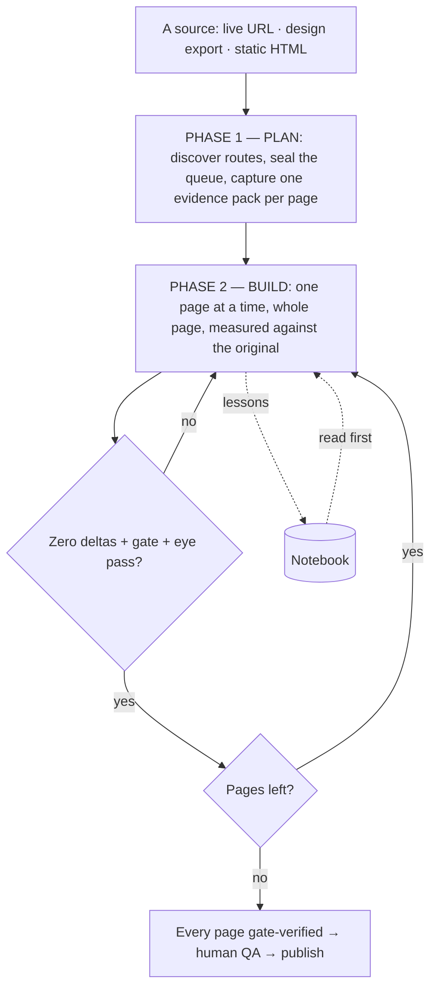

# How the Approach Works (plain language, end to end)

**The big idea in one line:** instead of rebuilding a website by hand, we turn the work into a calm, repeating routine —
plan it, then build one page at a time, checking each against the original — until the new store is a faithful copy.
Harness note: this is the doc you show a non-engineer; every noun below maps to a file in this repo.

**The cast:** **the Router** (`AGENT_GUIDE.md`, the front desk that points to the right guide) · **the Plan** (the sealed
route queue + one evidence pack per page) · **the Worker** (one agent invocation per page, fresh head, resumes from
disk) · **the Quality Gate** (`contract-diff.mjs` → `gate.json`: compares the new page to the original on desktop and
phone, by measurement) · **the Notebook** (`LEARNINGS.md`, promoted into `docs/`) · **the Runner** (`ralph.sh`: repeats
the worker until done, stops for explicit reasons) · **the Control Panel** (`demo/`: click Plan / Execute and watch).

## 1. The whole journey

## 2. Step 0 — start from a base theme
Every run begins from a committed **baseline theme** (a stock theme like Dawn, or the merchant's own theme pulled from
the store); its stock sections, assets and settings are the vocabulary the migration builds on, and `scripts/theme-baseline.sh
reset` returns to exactly that point for a fresh run.
## 3. Three inputs, one pipeline
A live URL is crawled for its routes; a design-tool export or any static HTML is dropped under `reference/` and served
locally (`__REF__`). From the queue onward nothing differs.
## 4. Why a fresh worker per page — and why it still remembers
A clear head makes fewer mistakes than a tired one; memory lives in files (contract, deltas, gate, interactions,
reports, LEARNINGS) that any next worker reads first. `--one-go` keeps one head for the whole queue — same files, same gates.
## 5. How we know it's right
Measure computed styles element-by-element (the verdict), screenshot sections by selector (the smoke detector), look at
the whole page side-by-side (the gestalt), at desktop and phone — then a dedicated eye-level pass.
## 6. When it stops
Finished · blocked on a human decision · a safety cap (iterations/budget/tokens) · stuck (no commits) · context blew
up · the provider failed. Each has an exit code and a playbook (`docs/principles/loop-and-exit.md`).
## 7. After it ships
Follow-up requests go through the same worker and gates (`scripts/follow-up.sh`); the retro (`scripts/ralph-retro.sh`)
reads the run logs and improves the harness itself.
