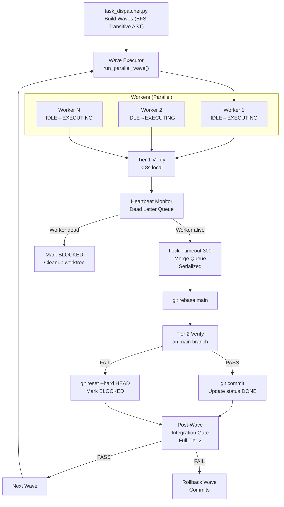

# 🔍 Phản Biện Kỹ Thuật: Upgrade Plan — Góc Nhìn Concurrency Throughput

> **Phạm vi phân tích:** Giám sát luồng, concurrency safety, throughput khi chạy nhiều worker song song  
> **Nguồn tham chiếu:** [`upgrade.md`](file:///Z:/home/avandall/project/boilerplate/upgrade.md), [`harness.sh`](file:///Z:/home/avandall/project/boilerplate/pipeline/scripts/harness.sh), [`state_machine.py`](file:///Z:/home/avandall/project/boilerplate/pipeline/engine/harness/state_machine.py), [`loop.py`](file:///Z:/home/avandall/project/boilerplate/pipeline/engine/harness/loop.py)

---

## 1. TỔNG QUAN ĐÁNH GIÁ

| Trụ cột | Độ hoàn chỉnh | Rủi ro Concurrency | Ưu tiên sửa |
|---|---|---|---|
| 1. Dynamic Concurrency + Wave | ⚠️ 65% | 🔴 CAO | P0 |
| 2. Run-Scoped Ephemeral | ✅ 80% | 🟡 TRUNG BÌNH | P2 |
| 3. System-Enforced Test Target | ✅ 85% | 🟢 THẤP | P3 |
| 4. Verification Matrix + OS Gate | ✅ 75% | 🟡 TRUNG BÌNH | P1 |
| 5. Architect/Editor Pattern | ⚠️ 60% | 🟢 THẤP | P3 |
| 6. Agentless --fix-bug | ✅ 80% | 🟢 THẤP | P3 |
| 7. Token Budget Awareness | ⚠️ 70% | 🟢 THẤP | P2 |

---

## 2. PHÂN TÍCH CHI TIẾT — PHẢN BIỆN TỪNG TRỤ CỘT

---

### 🔴 Trụ Cột 1: Concurrency & Wave — RỦI RO CAO NHẤT

#### ❌ Vấn đề 1.1: AST Import Graph quá nông — Không bắt được transitive coupling

**Điểm yếu trong plan:**

```python
# Plan hiện tại: CHỈ scan 1 lớp direct imports
task_imports = extract_ast_imports(task.files)
has_logic_coupling = bool(task_imports & wave_files)
```

**Vấn đề thực tế:**
```
TASK-A sửa: auth.py
TASK-B sửa: user_service.py

user_service.py import database.py
database.py import auth.py  ← Transitive dependency!

→ Plan hiện tại KHÔNG phát hiện được coupling này
→ Race condition vẫn xảy ra ở runtime
```

**Đề xuất:** Thêm BFS/DFS traversal đa lớp hoặc dùng `modulegraph`/`pyreverse` thay vì `ast` thuần:

```python
def extract_ast_imports_transitive(target_files, depth=3):
    """BFS traversal qua tối đa `depth` lớp import."""
    visited = set()
    frontier = set(target_files)
    for _ in range(depth):
        next_frontier = set()
        for f in frontier:
            if f in visited: continue
            visited.add(f)
            imports = _scan_direct_imports(f)
            next_frontier.update(imports)
        frontier = next_frontier
    return visited
```

---

#### ❌ Vấn đề 1.2: `build_waves()` — Greedy Algorithm gây starvation

**Điểm yếu trong plan:**

```python
# Thuật toán greedy: task nào vào trước được ưu tiên
for task in remaining:
    if not has_conflict and len(current_wave) < max_workers:
        current_wave.append(task)
```

**Vấn đề:** Task có nhiều file (complex) luôn bị đẩy vào Wave sau cùng (vì dễ conflict), gây **starvation** — task phức tạp nhất phải chờ đến cuối trong khi các Wave trước chạy task trivial.

**Đề xuất:** Sắp xếp trước theo priority + độ phức tạp giảm dần (Pack First Fit Decreasing):

```python
def build_waves(tasks, max_workers=3):
    # Sắp xếp task phức tạp (nhiều file) lên trước để tránh starvation
    tasks_sorted = sorted(tasks, key=lambda t: -len(t.files))
    ...
```

---

#### ❌ Vấn đề 1.3: `flock` - Race window giữa Tier 2 verify và `git merge`

**Điểm yếu trong plan:**

```bash
(
  flock -x 202
  git -C "$worktree_dir" rebase main
  git checkout main          # ← NGUY HIỂM: git checkout từ subshell có thể fail silently
  git merge --squash "ralph/${RUN_ID}/${task}"
  if python3 verify.py --tier 2; then
    git commit ...
  else
    git merge --abort        # ← Và đây là abort, không phải reset
  fi
) 202>"$lock_file"
```

**3 lỗi nghiêm trọng:**

1. **`git checkout main` trong subshell của worktree**: Nếu worktree đang ở branch khác, lệnh này thất bại âm thầm. Cần dùng `git -C "$REPO_ROOT" checkout main` tường minh.

2. **`git merge --abort` không restore working tree sạch**: Sau `--squash`, nếu verify fail, `--abort` không đủ — phải thêm `git reset --hard HEAD`.

3. **Tier 2 verify chạy ở `main` branch nhưng test target vẫn là file của worktree**: Nếu worktree path không được thêm vào PYTHONPATH lúc verify, test sẽ chạy sai scope.

**Đề xuất bổ sung:**

```bash
(
  flock -x 202
  git -C "$REPO_ROOT" fetch . "ralph/${RUN_ID}/${task}":staging_${task}
  git -C "$REPO_ROOT" checkout main
  git -C "$REPO_ROOT" merge --squash "staging_${task}"

  if PYTHONPATH="$REPO_ROOT:${PYTHONPATH}" python3 verify.py --tier 2 --test-target "$RALPH_TEST_TARGET"; then
    git -C "$REPO_ROOT" commit -m "[${task}] Integrated"
  else
    git -C "$REPO_ROOT" reset --hard HEAD   # ← Phải reset hard, không chỉ abort
    git -C "$REPO_ROOT" branch -D "staging_${task}" 2>/dev/null || true
  fi
) 202>"$lock_file"
```

---

#### ❌ Vấn đề 1.4: Không có timeout cho worker con — Wave có thể treo vô hạn

**Điểm yếu trong plan:**

```bash
execute_agent_for_task "$worktree_dir" "$task"  # ← Không có timeout
wait "${pids[@]}"                               # ← Đợi vô hạn nếu 1 worker treo
```

**Vấn đề:** Nếu một AI agent trong Wave bị context compaction (Exit 7) hoặc treo, toàn bộ Wave bị block. Throughput giảm xuống 0.

**Đề xuất:** Thêm `timeout` wrapper + wave-level timeout + partial success handling:

```bash
run_parallel_wave() {
  local WAVE_TIMEOUT="${RALPH_WAVE_TIMEOUT:-3600}"  # 1h default
  local pids=()
  local task_pids=()

  for task in $(get_tasks_in_wave "$wave_json"); do
    (
      timeout "$WAVE_TIMEOUT" execute_agent_for_task "$worktree_dir" "$task"
      local ec=$?
      if [[ $ec -eq 124 ]]; then  # timeout exit code
        safe_update_task_status "$task" "[!] BLOCKED"
        echo "TIMEOUT" > "${PIPELINE_DIR}/.ralph/worker_status/${task}.status"
      fi
    ) &
    task_pids+=("$! $task")
    pids+=($!)
  done

  # Partial success: không chờ tất cả mà poll định kỳ
  wait_with_partial_failure "${pids[@]}"
}
```

---

#### ❌ Vấn đề 1.5: `max_workers=3` hardcode — Không adaptive theo tài nguyên

**Plan đặt cứng `max_workers=3`** nhưng không xét:
- Số CPU cores thực tế của máy
- Memory available (mỗi AI agent process có thể ngốn 500MB+)
- API rate limit của provider (3 concurrent calls có thể bị throttle)

**Đề xuất:** Auto-detect + CLI flag:

```bash
# Tính max_workers dựa trên CPU cores và API quota
detect_max_workers() {
  local cpu_cores
  cpu_cores=$(nproc 2>/dev/null || sysctl -n hw.ncpu 2>/dev/null || echo 2)
  local mem_gb
  mem_gb=$(free -g 2>/dev/null | awk '/^Mem:/{print $7}' || echo 4)
  # Tối đa: min(cpu_cores, mem_gb/2, RALPH_API_RATE_LIMIT)
  local api_limit="${RALPH_PARALLEL_MAX:-3}"
  echo $(( cpu_cores < mem_gb/2 ? cpu_cores : mem_gb/2 ))
  # Bounded by API limit
}
```

---

### 🟡 Trụ Cột 4: Verification Matrix — MỘT ĐIỂM THIẾU QUAN TRỌNG

#### ❌ Vấn đề 4.1: Tier 2 verify trên `main` sau squash merge không detect regression từ interaction giữa 2 tasks

**Tình huống:**
```
Wave 1: TASK-A (sửa auth.py) ✅ Tier2 PASS → merge
Wave 1: TASK-B (sửa session.py) ✅ Tier2 PASS → merge

Nhưng: auth.py + session.py combined → regression test_auth_session fails
        (vì Tier2 chỉ chạy sau từng task merge, không chạy sau khi cả Wave hoàn thành)
```

**Đề xuất:** Thêm **Post-Wave Integration Gate** — chạy full Tier 2 một lần sau khi toàn bộ Wave đã merge:

```bash
run_parallel_wave() {
  # ... chạy và merge từng task ...
  wait "${pids[@]}"

  # POST-WAVE INTEGRATION GATE
  log_section "POST-WAVE INTEGRATION VERIFICATION"
  if ! python3 verify.py --tier 2 --full-suite; then
    log_error "🚨 POST-WAVE INTEGRATION REGRESSION DETECTED!"
    # Rollback toàn bộ Wave: git revert các commits của Wave này
    rollback_wave "$CURRENT_WAVE_COMMITS"
    exit 1
  fi
  log_ok "Post-wave integration gate PASS ✓"
}
```

---

### 🟡 Trụ Cột 2: State Machine — THIẾU ĐỒNG BỘ VỚI WORKER STATES MỚI

#### ❌ Vấn đề 2.1: `state_machine.py` hiện tại không có các states của parallel worker

**State machine hiện tại** ([`state_machine.py`](file:///Z:/home/avandall/project/boilerplate/pipeline/engine/harness/state_machine.py)):

```python
PipelineState.ORIENT → PLANNING → EXECUTING → REVIEWING → COMMITTING → DONE
```

**Plan upgrade thêm states mới** trong pseudo-code harness.sh:
```
IDLE → EXECUTING → VERIFIED_LOCAL → QUEUED_FOR_MERGE → REBASING → INTEGRATED → DONE
```

**Hai state machine song song không đồng bộ** → `loop.py` và `harness.sh` sẽ track state khác nhau cho cùng một task → observability bị mù.

**Đề xuất:** Cập nhật [`state_machine.py`](file:///Z:/home/avandall/project/boilerplate/pipeline/engine/harness/state_machine.py) để hợp nhất:

```python
class WorkerState(str, Enum):
    """State cho từng parallel worker (parallel mode only)."""
    IDLE = "IDLE"
    EXECUTING = "EXECUTING"
    VERIFIED_LOCAL = "VERIFIED_LOCAL"
    QUEUED_FOR_MERGE = "QUEUED_FOR_MERGE"
    REBASING = "REBASING"
    INTEGRATED = "INTEGRATED"
    DONE = "DONE"
    FAILED = "FAILED"
    TIMED_OUT = "TIMED_OUT"
```

Và `PipelineState` nên là wrapper của `WorkerState` khi ở parallel mode, hoặc dùng **mode discriminator** để tránh 2 enum rời rạc.

---

### 🟡 Trụ Cột 7: Token Budget — THIẾU METRIC FEEDBACK LOOP

#### ❌ Vấn đề 7.1: Ước tính `char_count / 4` quá thô — Không đủ để tránh Exit 7

**Plan hiện tại:**
```bash
estimate_tokens() {
  echo $(( ${#text} / 4 ))
}
```

**Vấn đề:** Hệ số 1 token ≈ 4 chars chỉ đúng với tiếng Anh ASCII. Với tiếng Việt UTF-8, 1 ký tự = 3 bytes → token ratio thực tế ~1.5-2 chars/token. Ước tính thấp ~50% → ngưỡng 12.000 tokens thực ra là ~6.000 tokens thực → KHÔNG bảo vệ đủ.

**Đề xuất:** Dùng tiktoken nếu có, fallback về UTF-8 byte count:

```python
def estimate_tokens(text: str) -> int:
    try:
        import tiktoken
        enc = tiktoken.get_encoding("cl100k_base")
        return len(enc.encode(text))
    except ImportError:
        # Fallback: byte-based estimation (more accurate for multibyte)
        byte_len = len(text.encode("utf-8"))
        return byte_len // 3  # Conservative for mixed Vietnamese/English
```

---

## 3. CÁC VẤN ĐỀ BỔ SUNG CHƯA ĐỀ CẬP TRONG PLAN

---

### 🔴 Thiếu: Worker Health Monitoring & Dead Letter Queue

**Plan không có cơ chế giám sát worker bị crash midway.** Khi một worker subshell crash (OOM, signal kill), bash chỉ nhận được exit code ≠ 0 sau khi `wait`. Không có visibility về:
- Worker nào crash lúc nào
- Task đó ở trạng thái gì khi crash (giữa EXECUTING hay REBASING?)
- Worktree có bị corrupt không?

**Đề xuất: Worker Heartbeat + Dead Letter Queue:**

```bash
# Mỗi worker định kỳ ping heartbeat
worker_heartbeat() {
  while true; do
    echo "$(date +%s)" > "${PIPELINE_DIR}/.ralph/heartbeat/${RALPH_WORKER_ID}.hb"
    sleep 10
  done
}

# Monitor: kill và BLOCKED task nếu heartbeat > 2x interval
monitor_worker_health() {
  for hb_file in "${PIPELINE_DIR}/.ralph/heartbeat/"*.hb; do
    local last_hb=$(cat "$hb_file")
    local now=$(date +%s)
    if (( now - last_hb > 60 )); then  # 60s no heartbeat
      local worker_id=$(basename "$hb_file" .hb)
      log_error "Worker $worker_id DEAD (no heartbeat). Moving task to DLQ."
      safe_update_task_status "${worker_task[$worker_id]}" "[!] BLOCKED"
    fi
  done
}
```

---

### 🔴 Thiếu: Distributed Lock Expiry — `flock` không tự expire

**`flock` trên Linux không có timeout by default.** Nếu process giữ lock bị kill (OOM killer), lock file vẫn bị giữ → deadlock vô thời hạn.

**Đề xuất:** Dùng `flock --timeout`:

```bash
(
  flock --exclusive --timeout 300 200  # Max 5 phút chờ lock
  if [[ $? -ne 0 ]]; then
    log_error "Merge queue lock timeout! Possible deadlock."
    safe_update_task_status "$task" "[!] BLOCKED"
    exit 1
  fi
  # ... merge logic ...
) 200>"$lock_file"
```

---

### 🟡 Thiếu: Worktree Leak Prevention khi interrupt

**Nếu user Ctrl+C giữa Wave, worktrees không bị dọn.** `cleanup_on_interrupt()` trong harness.sh hiện tại chỉ `pkill`, không:
- `git worktree remove --force` các worktrees đang active
- Xóa branches `ralph/${RUN_ID}/*`

**Đề xuất:** Track active worktrees và cleanup trong trap:

```bash
declare -a ACTIVE_WORKTREES=()
declare -a ACTIVE_BRANCHES=()

cleanup_on_interrupt() {
  echo "Cleaning up ${#ACTIVE_WORKTREES[@]} active worktrees..."
  for wt in "${ACTIVE_WORKTREES[@]}"; do
    git worktree remove --force "$wt" 2>/dev/null || true
  done
  for br in "${ACTIVE_BRANCHES[@]}"; do
    git branch -D "$br" 2>/dev/null || true
  done
  reap_orphans
  exit 130
}

trap cleanup_on_interrupt INT TERM
```

---

### 🟡 Thiếu: Observability — Không có per-wave throughput metrics

**`tracer.py` hiện tại** chỉ là stub đo latency của span đơn lẻ. Không có:
- Throughput per Wave (tasks/minute)
- Worker utilization (% thời gian EXECUTING vs WAITING_FOR_MERGE)
- Bottleneck detection (Wave nào chạy chậm nhất, tại sao)

**Đề xuất:** Mở rộng `PipelineTracer` hoặc emit structured log cho Wave:

```python
class WaveMetrics:
    def __init__(self, wave_id: int):
        self.wave_id = wave_id
        self.start_time = time.time()
        self.task_durations: dict[str, float] = {}
        self.merge_wait_times: dict[str, float] = {}

    def record_task(self, task_id: str, duration: float, merge_wait: float):
        self.task_durations[task_id] = duration
        self.merge_wait_times[task_id] = merge_wait

    def throughput(self) -> float:
        elapsed = time.time() - self.start_time
        return len(self.task_durations) / elapsed if elapsed > 0 else 0.0

    def bottleneck_task(self) -> str:
        return max(self.merge_wait_times, key=self.merge_wait_times.get, default="none")
```

---

### 🟡 Thiếu: Cơ chế retry có phân biệt lỗi deterministic vs transient

**Plan đề xuất `--fix-bug` flow nhưng không phân biệt** loại lỗi khi task fail:

| Loại lỗi | Hành động đúng |
|---|---|
| Compile error / import error | Retry KHÔNG có ích, phải fix code |
| API timeout / rate limit | Retry sau backoff |
| Test assertion failure | Retry = BLOCKED (cần human) |
| OOM / resource exhaustion | Retry với giới hạn resource mới |

**Đề xuất:** Phân loại lỗi trong `verify.py` trả về exit code có ý nghĩa:
```
Exit 10: Syntax/compile error (deterministic fail → BLOCKED)
Exit 11: Test assertion fail (deterministic → BLOCKED)
Exit 12: Resource/env error (transient → retry)
Exit 13: API error (transient → backoff retry)
```

---

## 4. ĐỀ XUẤT THAY ĐỔI SƠ ĐỒ LUỒNG WAVE



---

## 5. BẢNG ƯU TIÊN TRIỂN KHAI

| # | Vấn đề | Ưu tiên | Effort | Impact |
|---|---|---|---|---|
| 1 | `flock --timeout` tránh deadlock vô hạn | **P0** | Low | Critical |
| 2 | Wave-level timeout cho worker con | **P0** | Low | Critical |
| 3 | Post-Wave Integration Gate | **P0** | Medium | High |
| 4 | Worktree cleanup khi interrupt | **P0** | Low | High |
| 5 | `git reset --hard` thay `merge --abort` | **P0** | Low | High |
| 6 | Transitive AST Import Graph (BFS) | **P1** | Medium | High |
| 7 | Worker Heartbeat + Dead Letter Queue | **P1** | Medium | High |
| 8 | State machine sync với WorkerState | **P1** | Low | Medium |
| 9 | Per-wave throughput metrics | **P2** | Medium | Medium |
| 10 | Token estimate fix cho UTF-8 | **P2** | Low | Medium |
| 11 | Error type classification (exit codes) | **P2** | Medium | Medium |
| 12 | Adaptive max_workers detection | **P3** | Low | Low |
| 13 | Pack First-Fit Decreasing cho Wave | **P3** | Low | Low |

---

## 6. TÓM TẮT

Plan upgrade.md có nền tảng **đúng hướng** và tư duy phân tầng tốt. Tuy nhiên từ góc nhìn concurrency throughput, có **5 lỗ hổng P0 nghiêm trọng** có thể gây:

- **Deadlock vô hạn** nếu `flock` giữ lock khi process bị kill
- **Wave bị treo vô hạn** nếu 1 worker timeout nhưng `wait` không có deadline
- **Silent data corruption** nếu `git merge --abort` không đủ để restore main branch
- **Post-wave regression không bị detect** vì Tier 2 chỉ chạy per-task
- **Worktree leak** tích lũy khi interrupt làm `.git/worktrees/` phình to

Tất cả P0 đều có fix đơn giản (thêm flag, thêm hàm) — nên giải quyết trước khi implement bất kỳ trụ cột nào khác.
