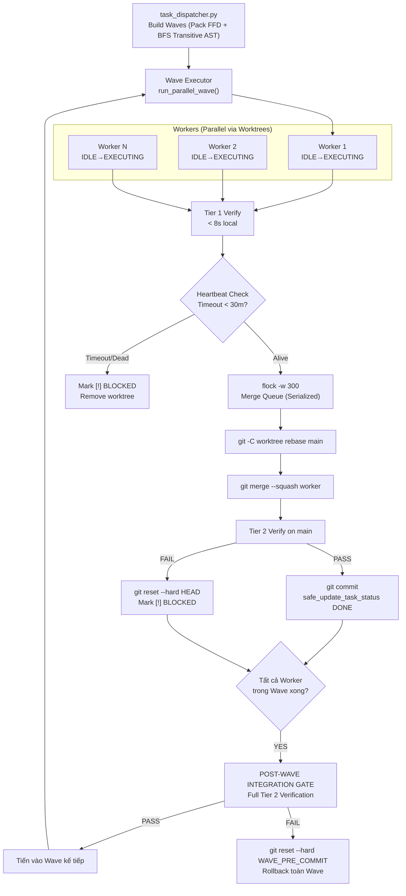

# 🚀 MASTER UPGRADE PLAN: NEXT-GEN HARNESS SPEED & CONCURRENCY (2026)

> **Tài liệu chuẩn hoá kiến trúc nâng cấp cho Pipeline Harness Engineering**  
> **Mục tiêu:** Tăng tốc độ sinh code gấp 2x – 3x, hỗ trợ chạy song song đa luồng an toàn, loại bỏ 100% nguy cơ xung đột naming/merge/logic, triệt tiêu context compaction và bổ sung chế độ sửa bug siêu tốc (Agentless pattern).  
> **Phiên bản:** 2.0 (Đã thẩm định và tích hợp toàn diện phản biện kỹ thuật từ `critique_upgrade_plan.md`).

---

## 1. TỔNG QUAN 7 TRỤ CỘT NÂNG CẤP

```
┌────────────────────────────────────────────────────────────────────────────────────────┐
│                                  7 TRỤ CỘT NÂNG CẤP                                    │
├────────────────────────────────────────────────────────────────────────────────────────┤
│ 1. Dynamic Concurrency & Serialized Integration Queue                                  │
│    Bộ điều phối Python thuần (0 token), AST BFS Transitive check, Pack FFD, Merge Wave│
├────────────────────────────────────────────────────────────────────────────────────────┤
│ 2. Run-Scoped Ephemeral Architecture & Durable Memory                                  │
│    Worktree tạm dọn sạch sau merge; tách biệt Runtime Ephemeral và Durable Memory Bridge│
├────────────────────────────────────────────────────────────────────────────────────────┤
│ 3. System-Enforced Test Target (Contract Gate)                                         │
│    Cưỡng chế chạy đúng file test bằng Environment Injection, bảo toàn 100% ý định phỏng vấn│
├────────────────────────────────────────────────────────────────────────────────────────┤
│ 4. Deterministic Verification Matrix & Multi-Tier OS Gate                             │
│    Cố định 4 điểm gọi verify.py, Post-Wave Integration Gate, reset --hard khi squash fail│
├────────────────────────────────────────────────────────────────────────────────────────┤
│ 5. Architect / Editor Pattern & Semantic Handoff Protocol                              │
│    Architect định nghĩa ý định ngữ nghĩa; Editor đọc code thật áp Search/Replace blocks.│
├────────────────────────────────────────────────────────────────────────────────────────┤
│ 6. Isolated --fix-bug Flow (Agentless Pattern)                                         │
│    Luồng sửa bug trúng đích độc lập 100% với flow tính năng.                           │
├────────────────────────────────────────────────────────────────────────────────────────┤
│ 7. Token Budget Awareness & Proactive Trimming                                         │
│    Đo lường token theo UTF-8 byte ratio, chủ động tỉa ngữ cảnh triệt tiêu Exit 7.      │
└────────────────────────────────────────────────────────────────────────────────────────┘
```

---

## 2. BẢNG KHẮC PHỤC CÁC ĐIỂM YẾU P0 TỪ PHẢN BIỆN KỸ THUẬT

| Lỗ hổng phát hiện (`critique_upgrade_plan.md`) | Mức độ | Hậu quả nếu không sửa | Phương án xử lý dứt điểm trong Spec v2.0 |
| :--- | :--- | :--- | :--- |
| **1. `git merge --abort` sau `--squash`** | **P0** | Lệnh `--abort` văng lỗi vì squash merge không tạo merge head $\rightarrow$ Main branch bị bẩn, kẹt lại code dở dang. | Dùng `git -C "$REPO_ROOT" reset --hard HEAD` để hoàn nguyên 100% working tree sạch. |
| **2. Deadlock vô hạn với `flock`** | **P0** | Nếu process bị kill/OOM khi đang giữ lock, các luồng khác sẽ treo vĩnh viễn. | Bổ sung cờ timeout cứng: `flock -x -w 300` (tối đa 5 phút chờ lock). |
| **3. Worker con treo làm đóng băng Wave** | **P0** | 1 worker bị timeout/loop vô hạn khiến `wait` đứng im, throughput về 0. | Bọc `timeout "$WAVE_TIMEOUT"` cho từng worker + Heartbeat file + Dead Letter Queue. |
| **4. Thiếu Post-Wave Integration Gate** | **P0** | Task A và Task B merge độc lập pass, nhưng kết hợp cả hai gây regression chéo. | Bổ sung **Post-Wave Integration Gate** (Chạy full Tier 2 sau khi toàn bộ Wave merge). |
| **5. Rò rỉ Worktree khi Ctrl+C** | **P0** | Người dùng ngắt giữa chừng làm rác `.git/worktrees/`, lần sau chạy bị đụng branch. | Mảng `ACTIVE_WORKTREES` tự động cleanup `remove --force` trong `trap cleanup_on_interrupt`. |
| **6. AST Import quá nông (1 lớp)** | **P1** | Bỏ sót quan hệ phụ thuộc gián tiếp ($A \rightarrow C \rightarrow B$) gây runtime crash. | BFS Transitive Import Traversal (độ sâu `depth=3`) trong `task_dispatcher.py`. |
| **7. Starvation do thuật toán Greedy** | **P1** | Task phức tạp (nhiều file) luôn bị đẩy về cuối cùng vì dễ conflict. | Sắp xếp **Pack First-Fit Decreasing (FFD)**: ưu tiên task lớn/nhiều file vào Wave trước. |
| **8. Đo token thô `char/4` sai lệch tiếng Việt** | **P2** | Tiếng Việt UTF-8 ngốn ~1.5–2 chars/token, ước tính thấp 50% gây auto-compaction Exit 7. | Dùng công thức bảo thủ: `byte_count // 3` (hoặc `tiktoken` nếu có). |

### 2.2. BẢNG KHẮC PHỤC CÁC ĐIỂM YẾU TỪ RE-CRITIQUE v2.1

| Lỗ hổng phát hiện (Re-Critique v2.1) | Mức độ | Hậu quả nếu không sửa | Phương án xử lý dứt điểm |
| :--- | :--- | :--- | :--- |
| **1. Thiếu assertion `main` branch trước merge** | **CRITICAL** | Merge `--squash` nhầm vào branch khác nếu HEAD bị lệch hoặc detached. | Kiểm tra `git symbolic-ref --short HEAD == main`, abort ngay nếu lệch. |
| **2. `reap_orphans` trước khi set `RALPH_RUN_TAG`** | **CRITICAL** | Chạy `pkill -f ""` diệt sạch mọi tiến trình trên máy nếu trap kích hoạt sớm. | Thêm guard `[[ -z "${RALPH_RUN_TAG:-}" ]] && return 0`. |
| **3. Commit message trên main lệch ngữ cảnh diff** | **CRITICAL** | Message trên main lấy diff từ worktree trước rebase thay vì squashed diff thực. | Thêm tham số `git_target` vào `generate_commit_message` để đo đúng diff trên main. |
| **4. Post-Wave failure làm lệch trạng thái Tasks_list** | **HIGH** | Code bị reset về pre-commit nhưng task đã lỡ ghi `[x] DONE`. | Cập nhật toàn bộ task trong wave về `[!] BLOCKED` khi post-wave gate thất bại. |
| **5. Rò rỉ `active_worktrees.txt` khi rollback wave** | **HIGH** | File registry tồn lưu rác worktree do `return 1` nhảy cóc khối cleanup. | Đảm bảo dọn dẹp worktree/branch và xóa `active_worktrees.txt` trên cả path failure. |
| **6. Regex escaping thiếu ký tự ERE trong sed** | **HIGH** | Task ID chứa ký tự lạ làm hỏng lệnh `sed -E` trong `safe_update_task_status`. | Dùng regex escape toàn diện: `sed 's/[][\\.^$*+?{}()|/]/\\&/g'`. |
| **7. Double-cleanup redundancy trong trap** | **MEDIUM** | Chạy git worktree remove lặp 2 lần (file registry và mảng memory). | Ưu tiên registry file, fallback mảng memory, reset mảng rỗng sau dọn dẹp. |
| **8. Thiếu bảo vệ duplicate `task_id` trong parser** | **MEDIUM** | Task trùng ID gây ghi đè cache và lập lịch wave sai lệch. | Thêm `seen_ids` kiểm tra và cảnh báo stderr trong `task_dispatcher.py`. |
| **9. Thứ tự gọi lifecycle vs preflight** | **MEDIUM** | Preflight chạy trước khi runtime dirs và `RALPH_RUN_TAG` được khởi tạo. | Đảo thứ tự: `init_run_lifecycle` trước `preflight_check`. |
| **10. Ranh giới logic coupling AST chưa rõ ràng** | **MEDIUM** | Mơ hồ giữa shared read-only imports và read-write hazard. | Quy định rõ: Cho phép shared read-only module; chặn triệt để read-write conflict. |
| **11. `_EXTRA_PY_PATHS` relative path `.`** | **LOW** | Relative path gây lệch module lookup khi cd vào worktrees khác. | Chuyển thành đường dẫn tuyệt đối chuẩn hóa theo `PIPELINE_DIR`. |
| **12. Docstring usage outdated trong dispatcher** | **LOW** | Ví dụ trong docstring không khớp cú pháp `argparse` mới. | Đồng bộ docstring khớp 100% cú pháp CLI `argparse`. |

### 2.3. BẢNG KHẮC PHỤC CÁC ĐIỂM YẾU TỪ RE-CRITIQUE v2.2

| Lỗ hổng phát hiện (Re-Critique v2.2) | Mức độ | Hậu quả nếu không sửa | Phương án xử lý dứt điểm |
| :--- | :--- | :--- | :--- |
| **1. Biến root global không được validate** | **CRITICAL** | `REPO_ROOT_DIR` bị sai silently nếu `PIPELINE_DIR` lệch, làm hỏng PYTHONPATH. | Đổi tên, thêm guard kiểm tra `[[ ! -d "$REPO_ROOT_DIR" ]]` và fail-fast. |
| **2. Commit rỗng trên main nếu generator lỗi** | **CRITICAL** | `generate_commit_message` trả về rỗng làm vỡ commit convention hoặc fail. | Thêm fallback commit message và kiểm tra kết quả `git commit`. |
| **3. Race window worktree add và registry** | **CRITICAL** | Ctrl+C rơi vào khoảng trống giữa tạo worktree và ghi file registry gây leak. | Áp dụng pattern **Write-Ahead Log (WAL)**: Ghi registry trước khi add worktree. |
| **4. Hardcoded File Descriptor (200, 201, 202)** | **HIGH** | Gây conflict nếu tiến trình cha hoặc tool ngoài đã dùng các FD này. | Chuyển toàn bộ sang cú pháp dynamic FD: `{lock_fd}>lockfile` của Bash 4+. |
| **5. AWK matching regex thay vì literal string** | **HIGH** | Task ID chứa ký tự lạ (dấu `.`, `+`) bị awk hiểu nhầm là regex pattern. | Dùng `index($0, tid) > 0` và `index($0, "### ") == 1` cho literal match. |
| **6. Rebase & Squash transparency** | **HIGH** | Rebase manual resolution có thể bị gộp vào commit diff của task mà không rõ nguồn gốc. | Thẩm định và tài liệu hóa: rebase conflict lập tức abort & BLOCKED, ngăn ô nhiễm main. |
| **7. Thứ tự kill worker trong interrupt trap** | **MEDIUM** | Remove worktree khi worker đang chạy gây lỗi cwd không tồn tại và crash ồn ào. | Gọi `reap_orphans` và `wait` trước khi xóa thư mục worktree. |
| **8. Shell expansion trong `bug_prompt` (P0 Injection)** | **MEDIUM** | `${error_input}` nằm trong double-quoted string khiến Bash expand `$(...)`. | Ghi error vào file cô lập bằng `printf '%s\n'` và chỉ truyền path vào prompt. |
| **9. Sentinel string rỗng `ralph-checkpoint-`** | **MEDIUM** | `target_task=""` tạo tag không hợp lệ trong git rev-parse. | Chỉ định nghĩa `ckpt_tag` khi `target_task` khác rỗng. |
| **10. Khả năng tương thích CLI của `task_dispatcher.py`** | **MEDIUM** | Người dùng truyền số workers hoặc path theo thứ tự cũ bị argparse báo lỗi. | Hỗ trợ phân tích linh hoạt cả tham số vị trí lẫn cờ `--tasks-file`/`--max-workers`. |
| **11. Kiểm tra exit status của git commit trên main** | **LOW** | Không phát hiện được lỗi khi git commit thất bại trên main. | Kiểm tra mã thoát của `git commit`, phân biệt no-op và lỗi staged thực sự. |
| **12. Phạm vi logic coupling transitive AST** | **LOW** | Cần đảm bảo tính nhất quán của AST BFS graph khi tính coupling. | Xác nhận thiết kế: cho phép shared read-only import, chặn triệt để read-write conflict. |

### 2.4. BẢNG KHẮC PHỤC CÁC ĐIỂM YẾU TỪ RE-CRITIQUE v2.3

| Lỗ hổng phát hiện (Re-Critique v2.3) | Mức độ | Hậu quả nếu không sửa | Phương án xử lý dứt điểm |
| :--- | :--- | :--- | :--- |
| **1. Yêu cầu Bash 4.1+ cho dynamic FD `{fd}>`** | **CRITICAL** | Parse error trên các môi trường Bash cũ (macOS default 3.2 hoặc container cũ). | Thêm check `BASH_VERSINFO` trong `preflight_check` (yêu cầu Bash >= 4.1). |
| **2. `echo "$error_input"` trong commit message** | **CRITICAL** | `echo` gặp `-e`/`-n` gây sai lệch; ký tự lạ phá vỡ lệnh `git commit`. | Dùng `printf '%s'`, lọc ký tự an toàn và áp dụng format chuẩn `fix(agentless): ...`. |
| **3. Sed pattern trong rollback `reg_file`** | **HIGH** | Path chứa ký tự đặc biệt làm sed xóa nhầm hoặc no-op. | Dùng `awk -v target="$worktree_dir" -F'\|' '$1 != target'` so khớp literal 100%. |
| **4. `fuser` list nhiều PIDs gây hiểu lầm holder** | **HIGH** | Log chẩn đoán ghi nhận PID của waiter thay vì holder thực sự. | Format danh sách `active_pids` rõ ràng thành "Lock contested by PID(s): ...". |
| **5. Argparse help output chưa tối ưu** | **HIGH** | Output `--help` hiển thị tham số vị trí khó hiểu. | Đặt `usage` chuẩn và định danh `metavar` trực quan cho tham số. |
| **6. `pkill -f` không chắc chắn diệt được worker** | **MEDIUM** | Worker subshell không chứa chuỗi `RALPH_RUN_TAG` trong argv. | Bổ sung mảng `GLOBAL_WORKER_PIDS` theo dõi và `kill -TERM` trực tiếp PID worker. |
| **7. Rò rỉ `error_report.txt` vào Git history** | **MEDIUM** | Traceback chứa thông tin nhạy cảm bị `git add -A` commit lên main. | Chuyển file sang `RUNTIME_DIR` và tự động `rm -f` trước khi commit. |
| **8. AWK match `index($0, tid)` quá rộng** | **MEDIUM** | Khớp nhầm dòng ghi chú comment hoặc log chứa chuỗi task ID. | Giới hạn chỉ match dòng bảng Markdown (`^\|`) hoặc heading (`^###`). |
| **9. Cấp phát dynamic FD thất bại nếu bảng FD đầy** | **MEDIUM** | `lock_fd` rỗng dẫn đến gọi lệnh `flock ""` văng lỗi không rõ ràng. | Thêm guard kiểm tra `[[ -z "${lock_fd:-}" ]]` báo lỗi fail-fast. |
| **10. Tên biến `REPO_ROOT_DIR` dễ xung đột env** | **LOW** | Trùng với biến môi trường của user khi source script. | Đổi tên biến nội bộ thành `_RALPH_REPO_ROOT`. |
| **11. Quy chuẩn commit message** | **LOW** | Thiếu convention scope trong commit. | Chuẩn hóa toàn bộ commit message theo `fix(pipeline): ...`. |

### 2.5. BẢNG KHẮC PHỤC SHOWSTOPPER TỪ RE-CRITIQUE v2.4

| Lỗ hổng phát hiện (Re-Critique v2.4) | Mức độ | Hậu quả nếu không sửa | Phương án xử lý dứt điểm |
| :--- | :--- | :--- | :--- |
| **1. Unbound variable `errors` trong `preflight_check`** | **SHOWSTOPPER** | `set -u` kích hoạt crash script ngay tại `errors: unbound variable`. | Khôi phục `local errors=0` ngay đầu hàm `preflight_check`. |

---

## 3. CHI TIẾT 7 TRỤ CỘT KÈM PSEUDO-CODE REVIEW

---

### Trụ Cột 1: Chạy Song Song Đa Luồng Động & Hàng Đợi Tích Hợp Tuần Tự (Concurrency & Integration)

#### 1.1. Bộ Điều Phối Thuần Python `task_dispatcher.py` (0 Token, < 10ms)
* **Khắc phục Starvation:** Áp dụng Pack First-Fit Decreasing (FFD), đưa các task phức tạp (nhiều files) lên trước.
* **Khắc phục Transitive Coupling:** Thuật toán BFS duyệt cây import đa tầng (mặc định `depth=3`).

##### 📝 Pseudo-code: `pipeline/scripts/task_dispatcher.py`
```python
# task_dispatcher.py — 0 Token Wave & Concurrency Scheduler (v2.0)
import ast, json, os, re, sys
from pathlib import Path

def parse_tasks_list(file_path):
    tasks = []
    for line in Path(file_path).read_text(encoding="utf-8").splitlines():
        if "| `TASK-" in line and "[ ] TODO" in line:
            tasks.append(extract_task_metadata(line))
    return tasks

def extract_ast_imports_transitive(target_files, depth=3):
    """BFS traversal qua tối đa `depth` tầng import để bắt transitive coupling."""
    visited = set()
    frontier = set(target_files)
    
    for _ in range(depth):
        next_frontier = set()
        for f_path in frontier:
            if f_path in visited or not os.path.exists(f_path) or not f_path.endswith(".py"):
                continue
            visited.add(f_path)
            try:
                tree = ast.parse(Path(f_path).read_text(encoding="utf-8", errors="ignore"))
                for node in ast.walk(tree):
                    if isinstance(node, ast.Import):
                        for a in node.names: next_frontier.add(module_to_path(a.name))
                    elif isinstance(node, ast.ImportFrom) and node.module:
                        next_frontier.add(module_to_path(node.module))
            except Exception:
                continue
        frontier = next_frontier
    return visited

def build_waves(tasks, max_workers=3):
    # Pack First-Fit Decreasing (FFD): Ưu tiên task phức tạp (nhiều file) lên trước chống starvation
    tasks_sorted = sorted(tasks, key=lambda t: len(t.files), reverse=True)
    waves = []
    remaining = list(tasks_sorted)
    
    while remaining:
        current_wave = []
        wave_files = set()
        wave_transitive_imports = set()
        unassigned = []
        
        for task in remaining:
            task_files = set(task.files)
            task_transitive = extract_ast_imports_transitive(task.files, depth=3)
            
            # Kiểm tra 1: File Disjoint vật lý
            has_file_conflict = bool(task_files & wave_files)
            # Kiểm tra 2: Transitive Logic Coupling
            has_logic_coupling = bool(task_transitive & wave_files) or bool(wave_transitive_imports & task_files)
            
            if not has_file_conflict and not has_logic_coupling and len(current_wave) < max_workers:
                current_wave.append(task)
                wave_files.update(task_files)
                wave_transitive_imports.update(task_transitive)
            else:
                unassigned.append(task)
                
        waves.append(current_wave)
        remaining = unassigned
    return waves

if __name__ == "__main__":
    max_w = int(sys.argv[1]) if len(sys.argv) > 1 else 3
    print(json.dumps(build_waves(parse_tasks_list("pipeline/docs/context/Tasks_list.md"), max_w)))
```

#### 1.2. Khóa Tránh Race-Condition Với Timeout & Giải Pháp B (PID Health Check)
* **Khóa file ngắn (`Tasks_list.md`, `Durable Logs`):** Dùng `flock -x -w 30` (chờ tối đa 30s) vì thao tác ghi text chỉ mất vài mili-giây.
* **Giải Pháp B cho Hàng Đợi Merge (`wait_and_acquire_merge_lock`):**
  * **Tránh timeout oan:** Không dùng 1 lệnh `flock -w 300` cứng (tránh trường hợp Worker trước chạy Tier 2 hợp lệ mất 6 phút làm Worker sau bị văng lỗi oan).
  * Vòng lặp chờ thử lại nhiều chu kỳ nhỏ (50s/chu kỳ). Nếu quá 15 phút, script kiểm tra PID đang giữ lock (`fuser` / `kill -0`):
    * Nếu tiến trình giữ lock vẫn sống và đang test $\rightarrow$ Gia hạn thời gian chờ.
    * Nếu tiến trình giữ lock đã chết (zombie/crash) $\rightarrow$ Báo cáo deadlock và tự động dọn stale lock.

##### 📝 Pseudo-code: Safe Locks trong `harness.sh`
```bash
# 1. Khóa cập nhật Tasks_list.md nguyên tử có timeout
safe_update_task_status() {
  local task_id="$1"
  local new_status="$2"
  local lock_file="${PIPELINE_DIR}/.ralph/locks/tasks_list.lock"
  mkdir -p "$(dirname "$lock_file")"

  (
    flock -x -w 30 200 || { log_error "Lock timeout updating $task_id"; return 1; }
    sed -i -E "s/(\|[[:space:]]*\`${task_id}\`[^|]*\|[^|]*\|[^|]*\|)[[:space:]]*\[[ /x!]\][[:space:]]*[A-Z_]+/\1 ${new_status}/" "${CONTEXT_DIR}/Tasks_list.md"
  ) 200>"$lock_file"
}

# 2. Khóa append nhật ký bền vững có timeout
safe_append_durable_log() {
  local log_file="$1"
  local content="$2"
  local worker_tag="[Worker ${RALPH_WORKER_ID:-1} | Task ${RALPH_ACTIVE_TASK:-CORE}]"
  local lock_file="${PIPELINE_DIR}/.ralph/locks/durable_log.lock"

  (
    flock -x -w 30 201 || { log_error "Lock timeout writing durable log"; return 1; }
    echo -e "\n### ${worker_tag} $(date '+%Y-%m-%d %H:%M:%S')\n${content}" >> "$log_file"
  ) 201>"$lock_file"
}
```

#### 1.3. Hàng Đợi Tích Hợp Tuần Tự (Serialized Merge) & Sửa Lỗi `--abort`
* **Sửa lỗi chí mạng:** Thay `git merge --abort` bằng `git -C "$REPO_ROOT" reset --hard HEAD` vì squash merge không tạo `MERGE_HEAD`.
* **Thao tác tường minh với `-C "$REPO_ROOT"`:** Tránh việc subshell worktree bị lẫn lộn thư mục gốc của Git.
* **Worker Watchdog & Heartbeat:** Từng worker con có heartbeat file; nếu đơ quá 60s hoặc vượt `WAVE_TIMEOUT` $\rightarrow$ Tự động chuyển task sang `[!] BLOCKED`.

##### 📝 Pseudo-code: Vòng lặp Worker & Merge Queue (v2.0)
```bash
declare -a ACTIVE_WORKTREES=()
declare -a ACTIVE_BRANCHES=()

cleanup_on_interrupt() {
  log_warn "Interrupted! Forcefully cleaning up ${#ACTIVE_WORKTREES[@]} active worktrees..."
  for wt in "${ACTIVE_WORKTREES[@]}"; do
    git worktree remove --force "$wt" 2>/dev/null || true
  done
  for br in "${ACTIVE_BRANCHES[@]}"; do
    git branch -D "$br" 2>/dev/null || true
  done
  reap_orphans
  exit 130
}
trap cleanup_on_interrupt INT TERM

run_parallel_wave() {
  local wave_json="$1"
  local WAVE_TIMEOUT="${RALPH_WAVE_TIMEOUT:-1800}" # 30 phút/wave
  local pids=()
  local REPO_ROOT="$(git rev-parse --show-toplevel)"
  local WAVE_PRE_COMMIT="$(git rev-parse HEAD)"

  for task in $(get_tasks_in_wave "$wave_json"); do
    local worktree_dir=".ralph/worktrees/${RUN_ID}/${task}"
    local branch_name="ralph/${RUN_ID}/${task}"
    ACTIVE_WORKTREES+=("$worktree_dir")
    ACTIVE_BRANCHES+=("$branch_name")

    (
      export RALPH_WORKER_ID="worker-$task"
      export RALPH_ACTIVE_TASK="$task"
      export RALPH_TEST_TARGET="$(get_test_target_from_table $task)"
      
      git worktree add -b "$branch_name" "$worktree_dir" main >/dev/null 2>&1
      
      # 1. State: EXECUTING (Có timeout bảo vệ)
      timeout "$WAVE_TIMEOUT" execute_agent_for_task "$worktree_dir" "$task"
      local agent_exit=$?
      if [[ $agent_exit -eq 124 ]]; then
        safe_update_task_status "$task" "[!] BLOCKED"
        log_error "Worker $task TIMED OUT. Aborting task."
        exit 124
      fi
      
      # 2. State: VERIFIED_LOCAL (Chỉ chạy Tier 1 cục bộ < 8s)
      PYTHONPATH="$worktree_dir:$PYTHONPATH" python3 pipeline/scripts/verify.py --tier 1
      git -C "$worktree_dir" add -A
      git -C "$worktree_dir" commit -m "[${task}] Local complete" >/dev/null 2>&1
      
      # 3. State: QUEUED_FOR_MERGE (Xếp hàng tuần tự có timeout 300s chống deadlock)
      (
        flock -x -w 300 202 || { log_error "Merge queue lock timeout!"; exit 1; }
        log_info "[MERGE-QUEUE] Worker $task entering serialized integration..."
        
        # 4. State: REBASING (An toàn vì AI đã dừng chạy)
        git -C "$worktree_dir" rebase main
        
        # 5. Integrate vào main (REPO_ROOT luôn ở main, không checkout làm dirty state)
        if ! git -C "$REPO_ROOT" merge --squash "$branch_name" >/dev/null 2>&1; then
          git -C "$REPO_ROOT" reset --hard HEAD
          git -C "$REPO_ROOT" clean -fd
          safe_update_task_status "$task" "[!] BLOCKED"
          exit 1
        fi
        
        # 6. Hard Gate Tier 2 trên main (Reset hard nếu fail!)
        if PYTHONPATH="$REPO_ROOT:$PYTHONPATH" python3 pipeline/scripts/verify.py --tier 2; then
          git -C "$REPO_ROOT" commit -m "[${task}] Integrated cleanly into main"
          safe_update_task_status "$task" "[x] DONE"
          log_ok "[INTEGRATED] Task $task merged successfully!"
        else
          # SỬA LỖI P0: Dùng reset --hard HEAD thay vì merge --abort
          git -C "$REPO_ROOT" reset --hard HEAD
          git -C "$REPO_ROOT" clean -fd
          safe_update_task_status "$task" "[!] BLOCKED"
          log_error "[INTEGRATION FAILED] Reverted task $task via reset --hard."
        fi
      ) 202>"${PIPELINE_DIR}/.ralph/locks/merge_queue.lock"
    ) &
    pids+=($!)
  done

  # Đợi toàn bộ worker trong Wave hoàn thành
  wait "${pids[@]}"

  # 7. POST-WAVE INTEGRATION GATE (Kiểm tra tương tác toàn cục cả Wave)
  log_section "POST-WAVE INTEGRATION GATE"
  if ! PYTHONPATH="$REPO_ROOT:$PYTHONPATH" python3 pipeline/scripts/verify.py --tier 2; then
    log_error "🚨 [WAVE REGRESSION] Cross-task interaction broke full test suite! Rolling back Wave..."
    git -C "$REPO_ROOT" reset --hard "$WAVE_PRE_COMMIT"
    exit 1
  fi
  log_ok "Wave integration verified 100% PASS ✓"
}
```

---

### Trụ Cột 2: Định Danh Theo Phiên & Bộ Nhớ Bền Vững (Run-Scoped & Durable Memory)

* **Vấn đề:** Chạy nhiều lần harness hoặc reset `TASK-001` làm đụng tên file/branch cũ; mất Memory Bridge nếu thư mục run bị reset hoàn toàn.
* **Giải pháp:** Tách biệt tài nguyên: **Durable Global Memory** (ở root runtime) và **Run-Scoped Ephemeral** (trong `runs/${RUN_ID}`).

##### 📝 Pseudo-code: Quản lý Thư mục Runtime & Symlink
```bash
init_run_lifecycle() {
  export RUN_ID="$(date +%Y%m%d-%H%M%S)"
  export RUN_DIR="${PIPELINE_DIR}/docs/runtime/runs/${RUN_ID}"
  mkdir -p "$RUN_DIR/plans" "$RUN_DIR/contracts" "$RUN_DIR/debates"

  # Cập nhật Symlink CURRENT và PREV
  local prev_run=$(readlink "${PIPELINE_DIR}/docs/runtime/CURRENT" 2>/dev/null || echo "")
  if [[ -n "$prev_run" && -d "$prev_run" ]]; then
    ln -sfn "$prev_run" "${PIPELINE_DIR}/docs/runtime/PREV"
  fi
  ln -sfn "$RUN_DIR" "${PIPELINE_DIR}/docs/runtime/CURRENT"

  # File DURABLE nằm ở cấp gốc (Không bao giờ bị xoá qua các runs)
  touch "${PIPELINE_DIR}/docs/runtime/DECISIONS_LOG.md"
  touch "${PIPELINE_DIR}/docs/runtime/LEARNINGS.md"
}

get_memory_bridge() {
  # Luôn đọc trí nhớ bền vững xuyên suốt mọi phiên
  local decisions_file="${PIPELINE_DIR}/docs/runtime/DECISIONS_LOG.md"
  tail -n 15 "$decisions_file" 2>/dev/null || true
}
```

---

### Trụ Cột 3: Cưỡng Chế `Test Target` Ở Tầng Hệ Thống (System-Enforced)

* **Vấn đề:** Phỏng vấn với AI xong chạy tool tự động làm mất/sửa task; AI lười gõ `verify.py` làm chạy test cả repo.
* **Giải pháp:** Thẩm định tĩnh Markdown `plan.sh check` (0 token, không ghi đè) + Tiêm ENV cưỡng chế `verify.py`.

##### 📝 Pseudo-code: `plan.sh check` & `verify.py` Fallback
```bash
# 1. plan.sh check — Kiểm tra tĩnh không ghi đè spec
plan_check() {
  local tasks_file="pipeline/docs/context/Tasks_list.md"
  local errors=0
  
  while IFS= read -r line; do
    if [[ "$line" =~ ^\|[[:space:]]*\`TASK- ]]; then
      local test_target=$(echo "$line" | awk -F'|' '{print $5}' | xargs)
      local task_id=$(echo "$line" | grep -oE "TASK-[A-Za-z0-9_-]+")
      if [[ -z "$test_target" || "$test_target" == "-" ]]; then
        echo -e "[ERROR] Task ${task_id} missing Test Target in column 5!"
        ((errors++))
      fi
    fi
  done < "$tasks_file"
  
  [[ $errors -eq 0 ]] && echo "Tasks_list.md validation passed ✓" || exit 1
}
```

```python
# 2. verify.py — Fallback đọc ENV nếu CLI không truyền cờ
def main():
    parser = argparse.ArgumentParser()
    parser.add_argument("--test-target", default="", type=str)
    args = parser.parse_args()

    # Cưỡng chế: Tự đọc biến môi trường do Harness tiêm
    effective_test_target = args.test_target or os.environ.get("RALPH_TEST_TARGET", "")
    
    if effective_test_target:
        print(f"🎯 Enforcing Targeted Test: {effective_test_target}")
        run_python_checks(test_target=effective_test_target, tier=effective_tier)
```

---

### Trụ Cột 4: Chuẩn Hóa Ma Trận Gọi `verify.py` & Chốt Chặn OS Gate Cứng

* **Phân định rõ ràng:**
  * **Đơn luồng (Sequential):** Chốt chặn Tier 2 nằm ở `check_and_auto_commit_done_task` trên `main`.
  * **Đa luồng (Parallel):** Trong worktree chỉ chạy Tier 1 (< 8s); Tier 2 Gate cứng nằm ở khâu Serialized Merge vào `main` và Post-Wave Integration Gate.

##### 📝 Pseudo-code: Chốt chặn OS Gate trước Commit (Sequential Mode)
```bash
check_and_auto_commit_done_task() {
  local done_task_id="$1"
  
  # BẮT BUỘC CHỐT CHẶN DETERMINISTIC TỪ OS:
  log_info "[COMMIT-GUARD] Running mandatory Tier 2 verification before commit..."
  if ! python3 "${PIPELINE_DIR}/scripts/verify.py" --tier 2 >/dev/null 2>&1; then
    log_error "🚨 [COMMIT-GUARD REJECTED] Tier 2 verification failed! Reverting status for [${done_task_id}]."
    safe_update_task_status "${done_task_id}" "[/] IN_PROGRESS"
    return 1
  fi

  # Chỉ commit khi OS verify thực sự trả về 0
  git add -A
  git commit -m "[${done_task_id}] Completed and Tier 2 Verified"
  log_ok "Working tree cleanly committed for ${done_task_id}."
}
```

---

### Trụ Cột 5: Mô Hình Architect / Editor & Semantic Handoff Protocol

* **Phân tách trách nhiệm:**
  * **Architect (Pro):** Chỉ viết **Ý định Ngữ nghĩa (Semantic Intent)**, không viết khối code Search cụ thể (tránh bị lệch indentation).
  * **Editor (Flash):** Đọc code thật từ file trên đĩa, tự sinh khối `<<<< SEARCH ... ==== REPLACE >>>>` chuẩn xác từng khoảng trắng.

##### 📝 Pseudo-code: Handoff Contract & Editor Execution
```json
// CONTRACT-${TASK_ID}.json do Architect sinh ra (Thuần ngữ nghĩa):
{
  "task_id": "TASK-002",
  "target_file": "src/services/auth.py",
  "target_anchor": "def verify_token(token: str) -> bool:",
  "semantic_spec": {
    "intent": "Bổ sung kiểm tra blacklist Redis trước khi giải mã JWT",
    "invariants": ["Không sửa signature của hàm", "Xử lý exception nếu Redis timeout trả về False"],
    "pseudocode": "if redis_client.is_blacklisted(token): return False\nreturn jwt.decode(...)"
  },
  "test_target": "tests/test_auth.py"
}
```

```text
// Editor đọc file auth.py thật và sinh ra block siêu nén:
src/services/auth.py
<<<<<<< SEARCH
    payload = jwt.decode(token, SECRET_KEY, algorithms=["HS256"])
    return True
=======
    if redis_client.get(f"blacklist:{token}"):
        return False
    payload = jwt.decode(token, SECRET_KEY, algorithms=["HS256"])
    return True
>>>>>>> REPLACE
```

---

### Trụ Cột 6: Luồng Chuyên Biệt `--fix-bug` (Agentless Pattern)

* **Lệnh chạy:** `./pipeline/scripts/harness.sh --fix-bug "<traceback hoặc lỗi>"`
* **Tính độc lập:** Không đụng `Tasks_list.md`, không đụng `plan.sh seal`.

##### 📝 Pseudo-code: Quy trình Sửa Bug 4 Bước
```bash
run_fix_bug_flow() {
  local error_log="$1"
  log_section "AGENTLESS BUGFIX MODE"
  
  # Bước 1: Localize (0.3s, 0 token LLM, an toàn 100% không shell injection qua stdin)
  local culprit_file
  culprit_file=$(printf "%s" "$error_log" | python3 -c '
import re, sys
text = sys.stdin.read()
matches = re.findall(r"File [\x22\x27](.*?(\.py|\.sh|\.json|\.ts|\.js))[\x22\x27], line (\d+)", text)
if matches:
    print(matches[-1][0])
else:
    m = re.search(r"([a-zA-Z0-9_\-\./]+\.(py|sh|json|ts|js))", text)
    print(m.group(1) if m else "")
' 2>/dev/null || echo "")
  log_info "🎯 Localized culprit file: $culprit_file"

  # Bước 2: Reproduce (Test Contract Red)
  local test_file="tests/reproduce/test_bug_reproduce.py"
  generate_reproducing_test "$culprit_file" "$error_log" "$test_file"
  python3 -m pytest "$test_file" && { log_error "Test must fail first!"; exit 1; }

  # Bước 3: Repair (1-Turn Single-shot với Model Flash)
  apply_targeted_search_replace "$culprit_file" "$test_file"

  # Bước 4: Verify & Commit
  if python3 "${PIPELINE_DIR}/scripts/verify.py" --tier 1 --test-target "$test_file"; then
    git add "$culprit_file" "$test_file"
    git commit -m "[BUGFIX] Resolved issue in $culprit_file"
    log_ok "Bugfix verified and committed cleanly ✓"
  else
    git checkout -- "$culprit_file"
    log_error "Fix failed verification. Reverted."
  fi
}
```

---

### Trụ Cột 7: Quản Trị Ngân Sách Token & Chủ Động Cắt Tỉa (Token Budget Awareness & Proactive Trimming)

* **Sửa lỗi công thức đo:** Áp dụng hệ số UTF-8 bảo thủ `byte_count // 3` thay cho `char/4` để tính đúng cả văn bản tiếng Việt.
* **Nguyên lý:** Đo token prompt trước khi gọi AI. Nếu vượt 12.000 tokens $\rightarrow$ Chủ động tỉa gọn log, triệt tiêu 100% lỗi dừng đột ngột Context Compaction (Exit 7).

##### 📝 Pseudo-code: Đo Lường & Cắt Tỉa Prompt Trước Khi Gọi Agent
```bash
estimate_tokens_multibyte() {
  local text="$1"
  # Dùng byte count chia 3: chính xác và an toàn cho tiếng Việt UTF-8
  local byte_count=$(printf "%s" "$text" | wc -c)
  echo $(( byte_count / 3 ))
}

_build_executor_payload_safe() {
  local active_task="$1"
  local raw_payload
  raw_payload=$(_build_executor_payload "$active_task")
  
  local est_tokens
  est_tokens=$(estimate_tokens_multibyte "$raw_payload")
  
  # Ngưỡng an toàn: 12.000 tokens cho system context
  if (( est_tokens > 12000 )); then
    log_warn "⚠️ [TOKEN BUDGET] Prompt size (${est_tokens} tokens) exceeds 12k safe limit. Proactively trimming..."
    
    # Proactive Trimming:
    # 1. Chỉ lấy 5 quyết định kiến trúc gần nhất thay vì 15
    local slim_bridge
    slim_bridge=$(tail -n 5 "${PIPELINE_DIR}/docs/runtime/DECISIONS_LOG.md")
    
    # 2. Cắt tỉa task spec (chỉ lấy đúng section của task active)
    local slim_spec
    slim_spec=$(get_task_spec "$active_task" | head -n 25)
    
    # 3. Tạo payload rút gọn tối ưu
    raw_payload=$(_build_slim_payload "$active_task" "$slim_spec" "$slim_bridge")
    log_ok "Prompt successfully trimmed down to $(estimate_tokens_multibyte "$raw_payload") tokens."
  fi
  
  echo "$raw_payload"
}
```

---

## 4. ĐỒ THỊ LUỒNG TỔNG THỂ (MERMAID ARCHITECTURE)



---

## 5. DANH SÁCH TỆP SẼ THAY ĐỔI / TẠO MỚI KHI IMPLEMENT

1. **`pipeline/scripts/task_dispatcher.py` (TẠO MỚI):**
   * Thuật toán phân tích Disjoint Files + AST BFS Transitive Graph (depth=3) + Pack First-Fit Decreasing (FFD) $\rightarrow$ Xuất Waves chạy song song (0 token).
2. **`pipeline/scripts/harness.sh`:**
   * Tích hợp cờ `--parallel [MAX_WORKERS]` gọi `task_dispatcher.py`.
   * Quản lý mảng `ACTIVE_WORKTREES` và dọn dẹp an toàn trong `trap cleanup_on_interrupt`.
   * Xây dựng hàng đợi tích hợp tuần tự (Serialized Integration Queue) có timeout lock (`flock -w 300`).
   * Sửa lỗi squash merge: Dùng `git -C "$REPO_ROOT" reset --hard HEAD` thay vì `git merge --abort`.
   * Tích hợp Post-Wave Integration Gate với cơ chế Rollback toàn Wave nếu có regression chéo.
   * Tích hợp `safe_update_task_status()` và `safe_append_durable_log()` bọc qua `flock -w 30`.
   * Thêm chốt chặn deterministic `verify.py --tier 2` OS Gate trước `git commit` (chế độ tuần tự).
   * Thêm hàm `estimate_tokens_multibyte()` và cơ chế Proactive Trimming (Trụ cột 7).
   * Thêm cờ `--fix-bug` chạy flow Agentless độc lập.
3. **`pipeline/scripts/verify.py`:**
   * Thêm fallback đọc `os.environ.get("RALPH_TEST_TARGET")` khi CLI không truyền `--test-target`.
4. **`pipeline/scripts/plan.sh`:**
   * Bổ sung subcommand `plan.sh check`: Thẩm định tĩnh Markdown (0 token), kiểm tra `Test Target` không phá vỡ spec của người dùng.
5. **`pipeline/docs/context/Tasks_list.md` (Template mẫu):**
   * Cập nhật schema chuẩn: `Domain/Scope`, `Target Files / Dirs`, `Test Target`, `Worker Lock`.
6. **`pipeline/prompts/` & `AGENT_GUIDE.md`:**
   * Cập nhật hướng dẫn Architect Semantic Specification và Editor Search/Replace block format.
